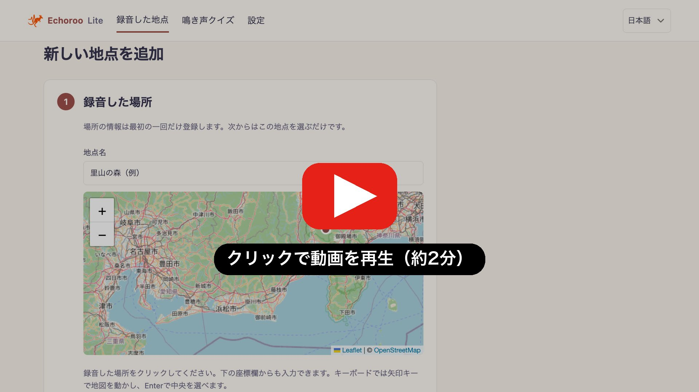
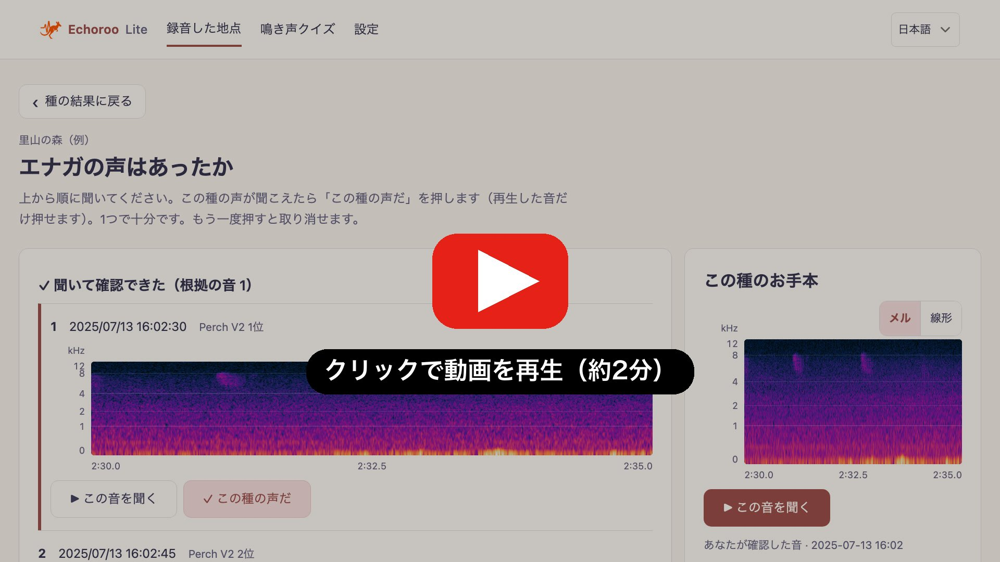
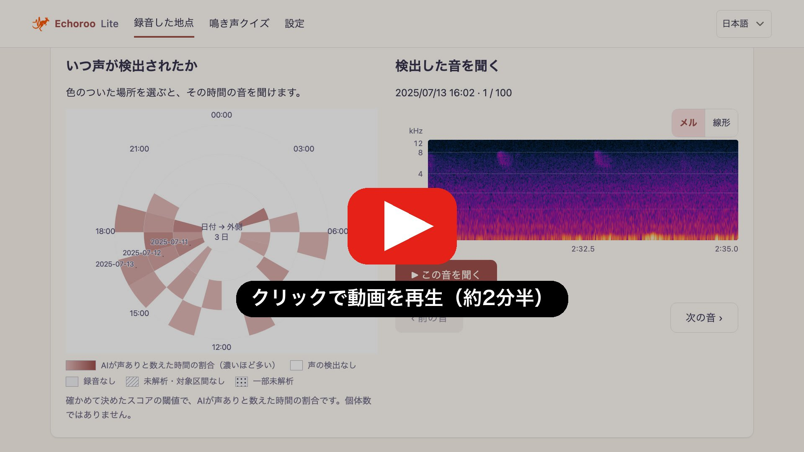
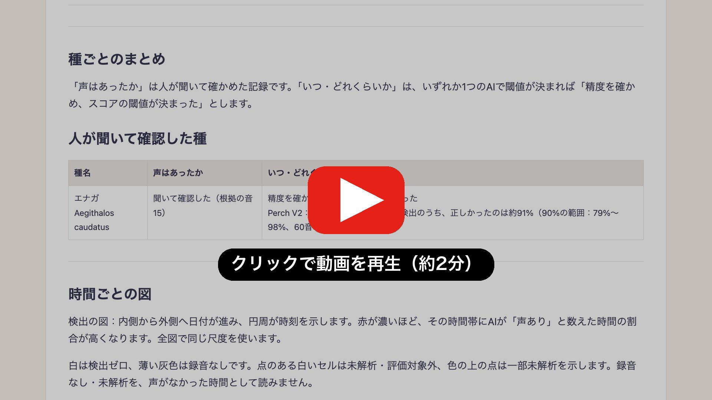
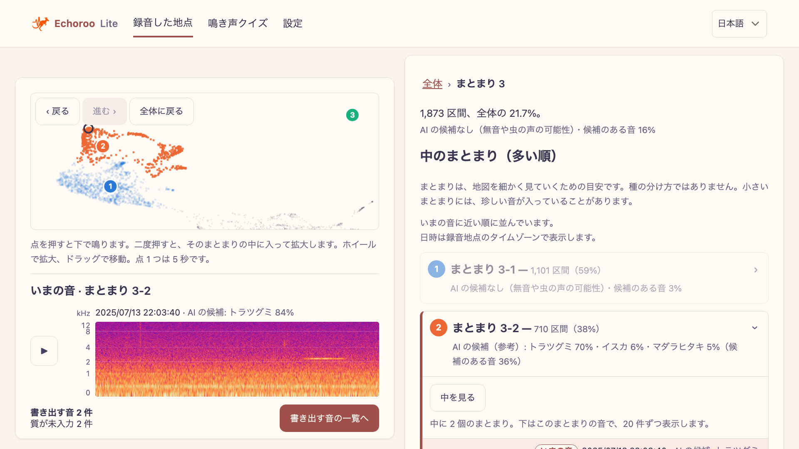

# Echoroo Lite

録音から鳥の声を AI で探し、人が聞いて確かめ、その結果を生物多様性のレポートにまとめるデスクトップアプリです。
自然共生サイトなどで、音によるモニタリングと報告書づくりに使うことを考えて作っています。
解析はインターネットにつながず、パソコンの中だけで行います。

**[ダウンロード](https://github.com/0kam/echoroo-lite/releases/latest)** · [インストールの手順](docs/install-guide.md) · [使い方の動画（8本）](https://www.youtube.com/playlist?list=PLbwxQUBHV7pg) · [English](#english)

> [!IMPORTANT]
> - **日本国内の録音にだけ使えます。** 種の一覧と種名を、日本の鳥に合わせて作っているためです。
> - **研究・教育などの非商用の目的に限ります。** アプリに BirdNET 2.4（CC BY-NC-SA 4.0）が入っているためです。

## 使い方

基本は次の 4 ステップです。▶ のリンクから、日本語の字幕つきの動画を見られます（版 0.2.1、録音は例のデータ）。

### 1. 録音を追加して解析する

▶ [動画（約2分）](https://youtu.be/sEFyyu5g3ZI)

録音した場所を地図で選び、録音のフォルダを指定します。元のファイルは移動も変更もしません。
はじめて使うときは解析に使う AI を選びます。そのとき、このパソコンで 1 時間の録音を解析するのにかかる時間を測ります。

- 使える録音：録音機で録った WAV・FLAC・MP3（モノラル）
- ファイル名に録音を始めた日時が必要です（例：`SM2-NP-05_20250710_100000.wav`、`REC_2025-07-10_10-00-00_001.wav`）



### 2. AI が見つけた種を聞いて確かめる

▶ [動画（約2分）](https://youtu.be/YLRrWf2ztx0)

地点のページに、AI が見つけた種が、見つけた数の多い順に並びます。
種を開くと、AI の点数が高い音から順に聞けます。その種の声だったら「この種の声だ」を押します。1 つ押せば、その種は「いる」と記録されます。



### 3. いつ・どれくらい鳴いたかを見る

▶ [動画（約2分半）](https://youtu.be/-BLj4wnpTeI)

種のページの図で、どの日のどの時刻に声が多かったかが分かります（円の向きが時刻、内側から外側へ日付）。図を押すと、その時間の音を聞けます。
「AI の精度を確かめる」で最大 60 の音に答えると、AI の見逃しと誤検出がどれくらいかが分かり、図に使う基準（スコアの閾値）が決まります。



### 4. レポートを書き出す

▶ [動画（約2分）](https://youtu.be/JO7wxgvA9Mo)

人が聞いて確かめた種の一覧、AI の精度、時間の図、根拠の音をまとめた HTML のレポートを書き出します。CSV と音声ファイルも一緒に保存されます。文章・表・図は、報告書の下書きにそのまま使えます。



（画像はアプリの動作を示すための例で、地点名と座標は仮のものです。）

## ほかにできること

- **AI が対応していない種を探す**（▶ [動画・約2分半](https://youtu.be/E0T2C1z_Pg0)）\
  セミやカエル、AI が見つけなかった鳥も、お手本の声（パソコンの中の音声か Xeno-Canto の録音）に似た音を録音から探せます。似ている度合いは、その種である確率ではありません。見つかった音は聞いて確かめます。Xeno-Canto を使うには、自分の API キーが要ります。
- **その種用の AI を育てる**（▶ [動画・約3分半](https://youtu.be/z4iChibER1E)）\
  約 20 の音に「声あり」「声なし」と答えると、その種だけを探す AI を作れます。答えを足して何度でも作り直せ、途中でやめて続きからもできます。内蔵の AI の精度が低い種にも使えます。
- **音の地図で探す（実験的）**（▶ [動画・約3分](https://youtu.be/WToubtWpu4g)）\
  録音の音を、似た音ほど近くに並べた地図にして、聞きながら探せます。名前を付けた音は、音声と一覧の ZIP に書き出せます。
  
- **鳴き声クイズ**（▶ [動画・約2分半](https://youtu.be/LZ9RBRJbfv4)）\
  声を聞いて鳥の名前を当てる練習です。覚えたい鳥の声を、自分の録音か Xeno-Canto から 2 種以上入れて始めます。アプリに鳥の録音は入っていません。

## 使える AI

| AI | 特徴 |
|---|---|
| **Perch V2**（おすすめ・最初から選ばれています） | Google が作った鳥の声の AI。いちばん正確です。 |
| **Kinglet-B / S / XS** | Perch 2.0 を元に、日本の鳥 317 種向けに小さくした AI（このアプリの作者が開発、[Kinglet](https://github.com/0kam/kinglet)）。Perch より約 2〜10 倍速く、精度は少し下がります。解析に時間がかかるパソコン向けです。 |
| **BirdNET 2.4** | 広く使われている鳥の声の AI。結果を比べたいときに追加します。 |
| **BirdNET+ V3.0（試験版）** | BirdNET の次の世代の試験版。比べる用です。 |

解析の中心にする AI を 1 つ選びます（似た音を探すときにも使います）。ほかの AI は、結果を比べたいときだけ追加します。

## 動作環境

| OS | 条件 |
|---|---|
| Windows | Windows 10 / 11（64 ビット、x64） |
| macOS | macOS 12 以降、Apple シリコン（M1 以降）。Intel の Mac には対応していません。 |
| Linux | 64 ビット（x86_64）。Ubuntu 22.04 以降など（`.deb` と AppImage） |

- メモリは 8 GB 以上をおすすめします。
- ディスクは、アプリに約 2 GB（AI を含む）、解析結果に録音 1 時間あたり数十 MB を使います。
- インストーラーには電子署名がありません。はじめての開き方は[インストールの手順](docs/install-guide.md)をご覧ください。
- インターネットは、地図の表示、Xeno-Canto の録音の取り込み、新しい版があるかの確認（起動時）にだけ使います。新しい版は「更新する」を押したときだけダウンロードします。あなたの情報や録音を送ることはありません。

## ライセンス

ソースコードは [Apache License 2.0](LICENSE) です。同梱の AI はそれぞれのライセンスに従います（[第三者通知](THIRD_PARTY_NOTICES.md)）。配布するアプリは BirdNET 2.4 を含むため、非商用に限ります。鳥の録音は同梱していません。**Powered by BirdNET.**

## English

Echoroo Lite is a desktop app that finds bird calls in recordings with AI, lets a person listen and confirm them, and turns the results into biodiversity reports, for acoustic monitoring at sites such as Japan's OECM sites (自然共生サイト). Analysis runs on your PC without an internet connection. [Download](https://github.com/0kam/echoroo-lite/releases/latest) · [Installation guide](docs/install-guide.md) (Japanese)

- **Japan only, non-commercial only**: species lists and names are built for birds in Japan, and the app includes BirdNET 2.4 (CC BY-NC-SA 4.0).
- **Steps**: add a folder of mono WAV/FLAC/MP3 files whose names include the start time (e.g. `SM2-NP-05_20250710_100000.wav`) → listen to the AI's top sounds to confirm each species → check the AI's accuracy (up to 60 sounds) to set the score threshold for its time charts → export an HTML report with CSV and audio files.
- **More**: find species the AIs do not cover from a reference call (similarity is not an identification probability), grow an AI for one species from about 20 answers, explore a sound map (experimental), and practise with a bird-call quiz.
- **AIs**: Perch V2 (default), [Kinglet](https://github.com/0kam/kinglet) B/S/XS (small models for 317 Japanese bird species), BirdNET 2.4 and BirdNET+ V3.0 preview for comparison.
- **Requirements**: Windows 10/11 x64, macOS 12+ on Apple silicon, or Linux x86_64. 8 GB RAM recommended. Installers are unsigned.
- **Internet**: only for the map, Xeno-Canto audio and checking for a new version at start-up. Nothing about you or your recordings is sent.
- **License**: source code under Apache-2.0; the distributed app is for non-commercial use.

## For developers

Prerequisites: Node.js 22.12+, Rust stable, Python 3.11 and the platform's [Tauri prerequisites](https://v2.tauri.app/start/prerequisites/). From the repository root on macOS:

```sh
uv venv --python 3.11
uv pip install --python .venv/bin/python -r apps/sidecar/requirements-dev.txt
npm ci
.venv/bin/python scripts/setup_models.py
npm run desktop
```

On Windows, use `.venv/Scripts/python.exe` instead of `.venv/bin/python`. Do not run `uv venv` over an environment you want to keep. Data goes to Tauri's app-data directory (`ECHOROO_DATA` overrides it); models come from `poc/models` in development (`ECHOROO_MODELS` overrides it).

Checks and packaging (freeze on the target OS; the build fails if a model is missing):

```sh
.venv/bin/python -m unittest discover -s apps/sidecar -p 'test_*.py'
npm run check
npm run build
cargo check --manifest-path apps/desktop/Cargo.toml
.venv/bin/python scripts/freeze_sidecar.py
npm run desktop:build
```

- Design and behaviour details moved from this README: [docs/development-notes.md](docs/development-notes.md)
- Status and remaining work: [docs/implementation-status.md](docs/implementation-status.md)
- Requirements: [docs/requirements.md](docs/requirements.md)
- Models, sources and licences: [docs/model-sources.md](docs/model-sources.md), [THIRD_PARTY_NOTICES.md](THIRD_PARTY_NOTICES.md)
