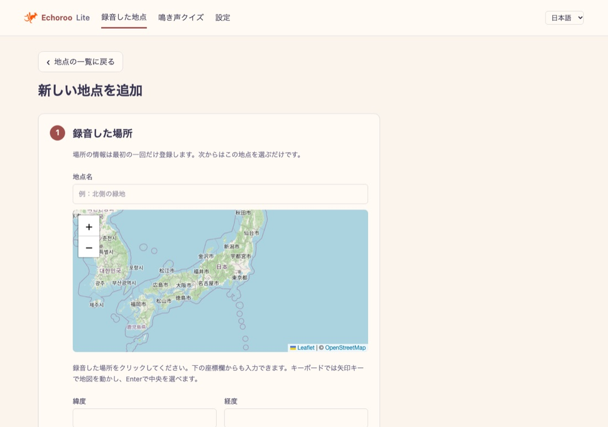
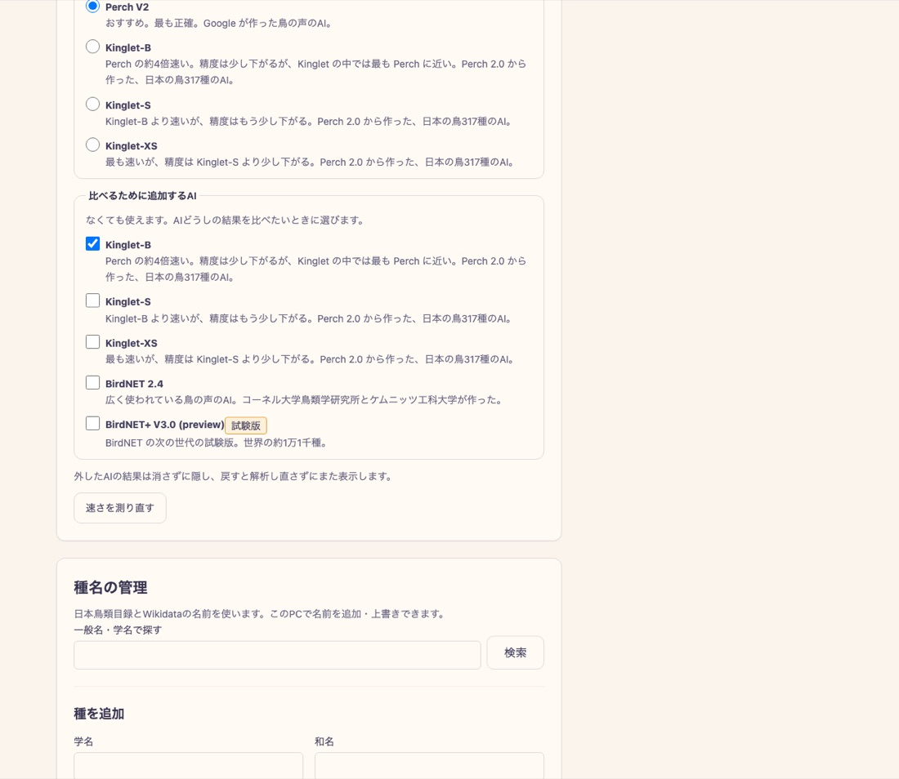
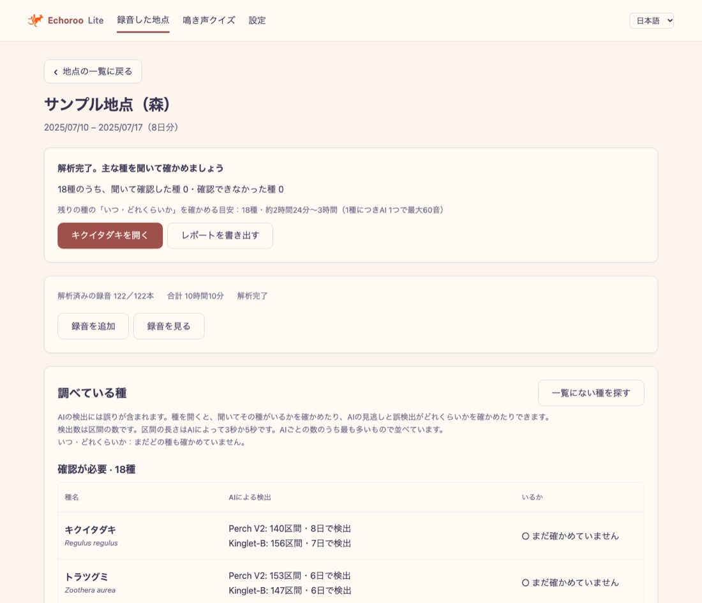
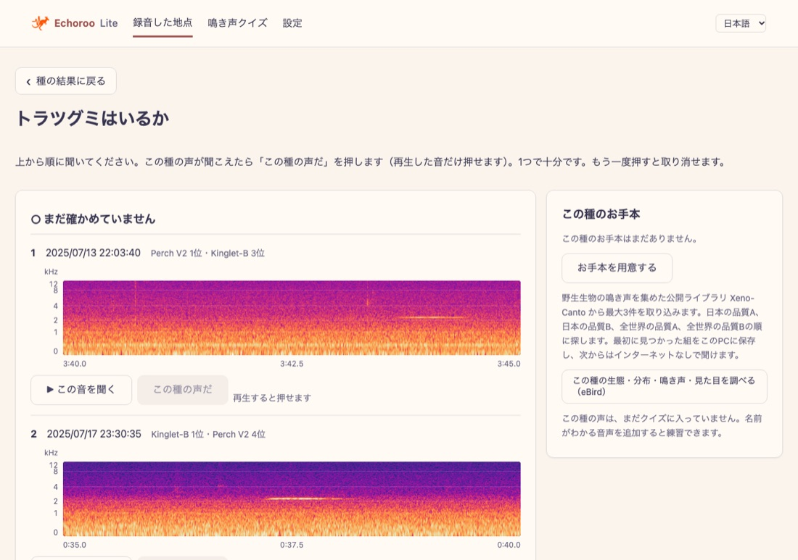
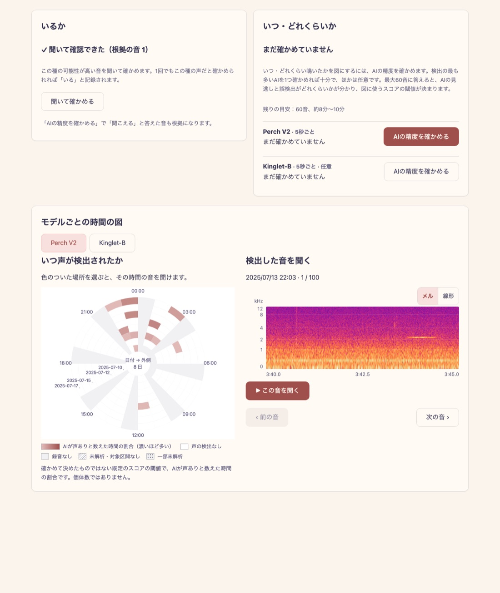
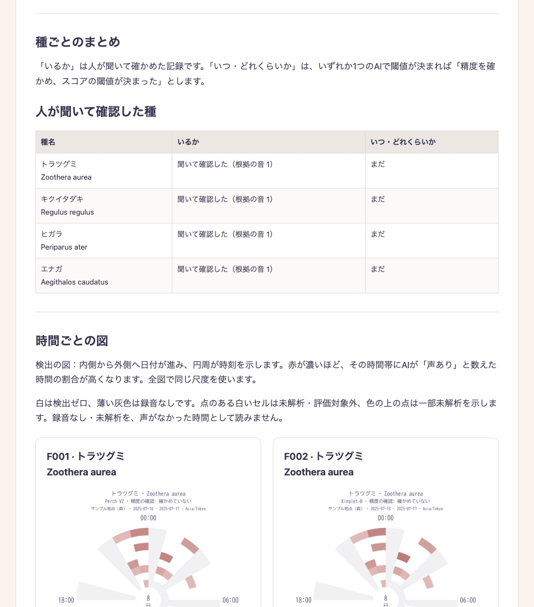
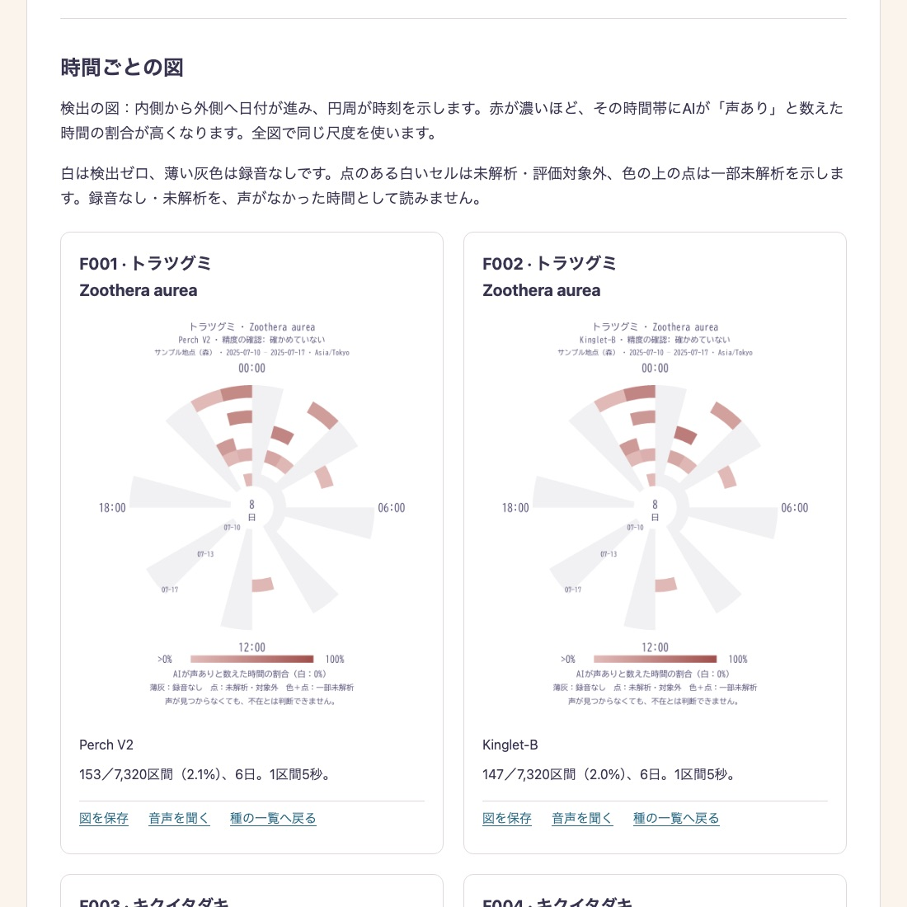

# Echoroo Lite

録音から鳥の声をAIで探し、人が聞いて確かめ、その結果を生物多様性のレポートにまとめるデスクトップアプリです。
自然共生サイトなどでの音によるモニタリングと、その報告書づくりを念頭に置いています。
解析はインターネットに接続せずにパソコンの中で行います。

[English summary](#english) · [ダウンロード（Releases）](https://github.com/0kam/echoroo-lite/releases) · [インストールの手順](docs/install-guide.md)

> **現時点では日本国内の録音での利用に限ります。** 判定の対象を日本の鳥の一覧に絞り、種名・地域の判定も日本向けに作っているためです。
> アプリは BirdNET 2.4（CC BY-NC-SA 4.0）を含むため、研究・教育などの**非商用目的に限り**使えます。

## 何を入れて、何をして、何が得られるか

| | 内容 |
|---|---|
| **入力** | 録音機で録った WAV / FLAC ファイル（モノラル）のフォルダと、録音した場所（地図で選ぶ）。ファイル名の最後に録音開始の日時（例：`SM2-NP-05_20250710_100000.wav`）が必要です。 |
| **操作** | ① 録音を追加して解析する → ② AIが見つけた種の一覧から種を開き、音を聞いて「いるか」を確かめる → ③ 必要な種は「AIの精度を確かめる」で最大60音に答え、スコアの閾値を決める → ④ レポートを書き出す |
| **出力** | HTMLのレポート（地点・期間、人が聞いて確かめた種の一覧、AIの精度、時間帯×日付の図、根拠の音）と、CSV・音声ファイル。報告書の下書きに本文・表・図をそのまま使えます。 |

### 1. 録音を追加して解析する

地図で録音した場所を選び、録音のフォルダを指定します。元のファイルは移動・変更しません。初回は解析に使うAIを選び、このパソコンでの解析の速さ（1時間の録音あたりの時間）を測ります。





### 2. AIが見つけた種を聞いて確かめる

地点のページに、AIが見つけた種が検出の多い順に並びます。種を開き、AIの点数が高い音から順に聞いて、その種の声なら「この種の声だ」を押します。1つで「いる」と記録されます。





### 3. いつ・どれくらい鳴いたかを見る

種のページでは、日付（内側→外側）と時刻（円周）ごとにAIが声ありと数えた割合を図にします。図のセルを押すと、その時間の音をスペクトログラムで見て聞けます。AIを切り替えて比べることもできます。「AIの精度を確かめる」で答えると、閾値と、その閾値以上の検出のうち正しかった割合がわかります。



### 4. レポートを書き出す





（画像はアプリの動作を示すための例で、地点名・座標は仮のものです。）

## 使えるAI

| AI | 内容 |
|---|---|
| **Perch V2**（既定・おすすめ） | Google が作った鳥の声のAI。最も正確です。 |
| **Kinglet-B / S / XS** | [Kinglet](https://github.com/0kam/kinglet) は、Perch 2.0 を公開データだけで小さく蒸留した、日本の鳥317種向けの軽量モデルです（Apache-2.0、このアプリの作者が開発）。Perch より約2〜10倍速く（B が最も遅く XS が最も速い）、精度は少し下がります（[モデルカード](https://github.com/0kam/kinglet/blob/main/MODEL_CARD.md)）。解析に時間がかかるパソコンで選んでください。 |
| **BirdNET 2.4** | 広く使われている鳥の声のAI。比較用に追加できます（非商用）。 |
| **BirdNET+ V3.0 (preview)** | BirdNET の次の世代の試験版。比較用です。 |

メインのAIは1つ選びます（似た音の検索にも使います）。ほかのAIは、結果を比べたいときだけ追加します。

## 動作環境

| OS | 条件 |
|---|---|
| Windows | Windows 10 / 11（64ビット、x64） |
| macOS | macOS 12 以降、Apple シリコン（M1 以降）。Intel の Mac には対応していません。 |
| Linux | 64ビット（x86_64）。Ubuntu 22.04 以降など。`.deb` と AppImage を用意しています。 |

- メモリ 8GB 以上をおすすめします。
- ディスク：アプリ本体に約2GB（AIのモデルを含みます）。解析結果の保存に、録音1時間あたり数十MB（使うAIの数によって増えます）。
- インストーラーには電子署名がありません。初回の開き方は[インストールの手順](docs/install-guide.md)をご覧ください。
- 地図の表示と、クイズ用のお手本の取り込み（Xeno-Canto）にはインターネットを使います。

## ライセンス

ソースコードは [Apache License 2.0](LICENSE) です。同梱のAIモデルはそれぞれのライセンスに従います（[第三者通知](THIRD_PARTY_NOTICES.md)）。配布するアプリは BirdNET 2.4 を含むため非商用に限ります。鳥の録音は同梱していません。**Powered by BirdNET.**

## English

Echoroo Lite is a desktop app that finds bird calls in recordings with AI, lets a person listen and confirm them, and turns the results into biodiversity reports. It is designed for acoustic monitoring and reporting at sites such as Japan's OECM sites (自然共生サイト). Analysis runs locally without an internet connection.

- **Japan only for now**: species lists, names and range marks are built for birds in Japan.
- **Input**: a folder of mono WAV/FLAC files whose names end with the start time (e.g. `SM2-NP-05_20250710_100000.wav`) and the site location.
- **Steps**: add and analyse recordings → listen to the AI's top sounds to confirm presence → optionally check the AI's accuracy (up to 60 sounds) to set a score threshold → export a report.
- **Output**: an HTML report (site and period, confirmed species, AI precision, date × time-of-day charts, evidence audio) plus CSV and audio files.
- **AIs**: Perch V2 (default), [Kinglet](https://github.com/0kam/kinglet) B/S/XS (small models distilled from Perch 2.0 for 317 Japanese bird species, by the author of this app), BirdNET 2.4 and BirdNET+ V3.0 preview for comparison.
- **Requirements**: Windows 10/11 x64; macOS 12+ on Apple silicon; Linux x86_64 (Ubuntu 22.04+ or similar). 8 GB RAM recommended; about 2 GB of disk for the app plus tens of MB per recorded hour for results. Installers are unsigned.
- **License**: source code under Apache-2.0; the distributed app is for non-commercial use because it includes BirdNET 2.4 (CC BY-NC-SA 4.0).

## Developer notes

The single distributed edition includes BirdNET 2.4, Perch V2,
Kinglet-B, Kinglet-S, Kinglet-XS and BirdNET+ V3.0 (preview).
The default main AI is Perch V2, with no comparison AIs selected. Users can choose
Perch, Kinglet-B, Kinglet-S or Kinglet-XS as the main AI; similarity search and custom models
use that AI's saved 1536-dimensional embeddings. Deselected
results are retained and hidden until selected again. The first-run chooser and
offline speed benchmark use the [model API contract](docs/model-selection-api.md).
Kinglet v0.2.0 scores are softmax probabilities over 318 classes with the background
channel dropped (default detection threshold 0.1). BirdNET+ developer
preview 3.1 is comparison-only; its CC BY-SA 4.0 terms restrict use to research
and evaluation and prohibit poaching and military use.
See [model sources](docs/model-sources.md) and [third-party notices](THIRD_PARTY_NOTICES.md).

- Installation (Windows, macOS, Linux; unsigned-app warnings): [docs/install-guide.md](docs/install-guide.md)
- Third-party models, data and licences: [THIRD_PARTY_NOTICES.md](THIRD_PARTY_NOTICES.md)
- Implementation status and remaining work: [docs/implementation-status.md](docs/implementation-status.md)
- UI review handoff: [docs/UI-REVIEW-HANDOFF-2026-09-24.md](docs/UI-REVIEW-HANDOFF-2026-09-24.md)
- Fixed 30-window validation QA: [docs/validation-effort-qa-2026-09-24.md](docs/validation-effort-qa-2026-09-24.md)
- Mac workflow QA, measured effort, and remaining checks: [docs/release-readiness-2026-09-22.md](docs/release-readiness-2026-09-22.md)
- Requirements: [docs/requirements.md](docs/requirements.md) (initial scope accepted)
- Design baseline: [docs/plan.md](docs/plan.md) (2026-07; requirements review reopened 2026-09)
- Session handoff: [docs/HANDOFF-2026-09.md](docs/HANDOFF-2026-09.md)
- M0 PoC artifacts: [poc/](poc/)

The full Echoroo repository (`0kam/echoroo`) remains the salvage/reference
source; Lite never merges back.

## Development preview

The first slice registers Site > Dataset recordings in place, runs the included
models, saves scores and embeddings, and searches by a spectrogram-selected audio
interval. Xeno-Canto key settings, search and selected downloads are implemented and
verified against the live service in the Mac release app. Reports provide species
summaries, evidence audio, spiral plots and portable HTML reports with CSV/SVG/PNG/audio
ZIP exports. The practice quiz uses clips added by users from their own recordings
or Xeno-Canto with their own API key. No bird-call recordings are bundled in the app.
It supports custom sets, selected audio clips and saved first answers. Windows
acceptance and an independent, unseen-audio capability test remain pending.

Each species page answers two questions with two cards (proposal:
[species flow](docs/species-flow-proposal-2026-09-30.md)).

- **Is it here?** — **Listen and confirm** lists the sounds most likely to be the species,
  from the top: 15-second windows interleaved from each model's score ranking (BirdNET,
  Perch and a species model), labelled with the model that flagged them, or — for a
  searched species — its 5-second search hits by similarity. The only action is
  **This is its call** (press again to undo). One mark confirms the species; marked sounds
  and "Heard" answers from steps ② and ③ below become report evidence (step ① answers do
  not). When nothing is found, **Record that it could not be confirmed** saves
  "listened to the top N sounds without confirming", where N is the unbroken run of
  played sounds from the top.
- **When and how much?** — each model is checked on its own: ① 20 sounds from the
  threshold-setting days, one per equal-width bin of the model's logit score (empty bins
  are filled from the others; no adaptive re-selection). A Firth-penalised logistic curve
  of "heard" against logit score sets the lowest threshold at which the fitted share of
  calls among windows at or above it is at least 90%. If nothing was heard, or scores and
  answers show no positive relation, the check states that no threshold could be set and
  nothing is counted (no default is used). ② and ③ are the fixed 30-sound accuracy and
  optional missed-call samples from the other days. An answer about one 15-second window
  of a species is reused by that species' other models. A check (all its ①–③ answers not
  used by another model's check) can be deleted from the species page.

Recordings are split into threshold-setting and checking halves by local day (by
recording when there is only one day), reproducibly per site and hidden from users. See
[the validation design](docs/validation-design.md) for sampling and uncertainty.

A **species model** is built on its own page from the species' search: label 5-second
search hits **Voice / No voice**; "Not heard" answers from steps ② and ③ add no-voice
material (each 15-second window as three 5-second pieces). At least three of each are
needed. The fixed Perch-embedding classifier is applied to the site's recordings, its
15-second score is the maximum of three pieces, and it is checked like BirdNET and Perch
(windows it learned from are left out of its check).

Spectrograms use a 16 ms Hann window, 2 ms steps and 2× zero padding, with the
Roseus palette and a linear frequency axis. The same display settings apply to
recordings, references, quizzes and new report figures; exports retain the FFT
settings. These display choices do not change audio, model scores or annotations.

Prerequisites: Node.js 22.12+, Rust stable, Python 3.11 and the platform's Tauri
build prerequisites. The UI uses the [official SvelteKit static configuration](https://v2.tauri.app/start/frontend/sveltekit/).

From the repository root on macOS:

```sh
uv venv --python 3.11
uv pip install --python .venv/bin/python -r apps/sidecar/requirements-dev.txt
npm ci
.venv/bin/python scripts/setup_models.py
npm run desktop
```

On Windows, create `.venv` with Python 3.11 and replace `.venv/bin/python` with
`.venv/Scripts/python.exe`. Install the Python requirements with that interpreter
(`python -m pip install -r ...`) or uv. Developers run `setup_models.py` without
`--perch-only`; development and release builds include BirdNET 2.4, BirdNET V3, Perch and all three Kinglet v0.2.0 models.
Installed apps already include these models and need no model setup or network access for analysis.
Kinglet assets are downloaded from the [v0.2.0 release](https://github.com/0kam/kinglet/releases/tag/v0.2.0)
under `models/kinglet/kinglet-{b,s,xs}-v0.2.0.onnx` and matching `.classes.csv` names.
Only default variants are bundled; gemm-mel variants are excluded. To copy local files instead, use
`.venv/bin/python scripts/setup_models.py --kinglet-from poc/models/kinglet-v0.2.0`
with the same pinned checksum verification before copying.
Do not run `uv venv` over an existing environment you want to keep.

In the app, add a site (latitude/longitude and IANA timezone), choose a folder,
review the import, then register it. The imported recording group gets a folder-based
name by default and can be renamed later. This slice accepts
mono WAV/FLAC whose filenames end in `YYYYMMDD_HHMMSS`. It scans subfolders and
skips registered paths, invalid dates, unsupported channels and unreadable files.
Choose a recording and run analysis; candidate interval buttons play and stop
at that interval. Japanese/English is selectable and persisted.
Large recording groups show 100 rows per page and can be filtered by the recording
date in the site's local time. Filtering the list does not change the scope of
**Analyze recording group**.

To search, open search from the site list or a species page, choose the species and
reference audio from this PC or Xeno-Canto, then drag a time interval on the spectrogram
or enter its start/end in seconds. Add one or more intervals as examples and start the
search; the reference selection can be 0.2–30 seconds and the display loads only 5–60
seconds at a time. Stereo references are averaged to mono. Each species has exactly one
search per site; when it finishes, the app opens that species' **Is it here?** list of
search results. To search again, delete the search on the species page first: the
confirmation lists what goes with it — its "This is its call" marks, not-found records,
voice/no-voice labels and any species model built from it (with that model's check).

Search uses all embeddings, without species/region filtering, from the latest
compatible Perch analysis per recording in the selected group. The reference interval
itself is excluded. Similarity is the maximum cosine over the references. Searches are
not detectors for reporting: they have no threshold, no accuracy check and no time
chart. Similarity is not an identification probability, nor evidence of absence. See
[search implementation](docs/search-implementation.md).

From a site's results, choose **Export report**, keep or change the included species,
and select a destination folder. The app saves a readable `index.html` with native
text and tables, species plots, validation results, supplementary quiz practice
records and playable audio. **Copy text and tables** supports drafting in Word;
**Save figure** provides a labelled PNG. PDF and DOCX generation are not included.
The same contents are packaged in a ZIP: recipients extract it before opening
`index.html`. All report resources are local; no web service is needed for playback.

The report's species table has two columns: **Present** (confirmed by listening with
the number of evidence sounds / listened to the top N without confirming / not checked)
and **When and how much** (the models whose check met the accuracy goal). Time charts
are grouped in model tabs and include unchecked, goal-missed and undecided models with
that status stated. Detection counts use complete 15-second windows; a checked threshold
applies to all eligible intervals, including unreviewed ones, and an unchecked model
uses the default threshold labelled "not checked". AI examples, evidence sounds and
check answers remain separate. Saved files retain their original recording scope,
analysis, thresholds, answers and contemporaneous quiz records. See
[report implementation](docs/report-implementation.md) for provenance and verification limits.

Step ② fixes at most 30 predicted-positive windows per species and model before
answers are seen. The formal precision result is calculated only after every fixed window
is answered: a one-sided 95% lower bound of at least 80% meets the goal. Progress can be
saved and resumed, but interim answers never provide a guarantee or automatic pass.
Step ③ (recall) is optional and samples missed detections; precision alone does not
establish recall. Corrections retain their history and never rewrite saved exports.
Detection truth is presence anywhere in 15 seconds, compared with the maximum of five
BirdNET 3-second scores or three Perch 5-second scores. BirdNET predictions used as a
functional QA oracle are provisional test data, not scientific ground truth.

The 30-window limit is a design choice. Earlier overlap-reduction estimates are
simulations, not measurements of human effort. Source-web QA, production web,
Mac `.app` and DMG builds have passed. Native Mac checks cover starting, saving,
resuming and correcting evaluations, results and local HTML playback. Windows has
not been tested. See the [fixed-sample QA record](docs/validation-effort-qa-2026-09-24.md).

Open **Bird-call quiz** and use **Add a question from audio** to add clips from
this PC or Xeno-Canto with your own API key. No bird-call recordings are bundled.
A spectrogram-selected 0.2–60-second interval is copied into app data, with source
credits retained. No field-recording import is required. Select at least two
species and save a named set, then start a session. Answers, unknowns and progress
are saved; results allow review and replay. Credits and licences appear after each answer.
These are learning results, not estimates of identification ability or field precision/recall.
See [quiz implementation and source details](docs/quiz-implementation.md).

Species show a common name in the selected language together with the scientific
name. The offline catalog uses the Checklist of Japanese Birds and Wikidata plus local additions; **Species names**
lets you search, add taxa and override Japanese/English names. Empty fields restore
bundled names. Exact matches rank above prefixes and substrings. Perch shares names on exact scientific-name matches; missing names
fall back to English, then the scientific name. Original predictions stay unchanged.
The logo and light/dark palette come from Echoroo full. Details and provenance:
[species and branding](docs/species-and-branding.md).

To use Xeno-Canto, open **Recordings and search → Reference audio → Find reference audio on Xeno-Canto**,
expand the API key settings and save your key. Then select
a target species, and search by country and exact A–E quality rating. Download only
a recording you select, then choose its interval on the same spectrogram. XC ID,
recordist, source URL and license are retained. Downloaded XC references work offline.
The key is stored in the app's data directory and is never returned by the API;
save an empty value to remove it. Live search, attributed download, spectrogram selection
and similarity search were verified in the Mac release app on 2026-09-09.

Data defaults to Tauri's app-data directory (`~/Library/Application Support/org.echoroo.lite`
on macOS). `ECHOROO_DATA` overrides it for development. Models default to `poc/models`
in development and the app's bundled read-only resources in a release;
`ECHOROO_MODELS` overrides this.
The database, `analyses/` score archives and source audio references belong together.
Imported field recordings and local references stay in place; selected XC downloads
and quiz audio are app-managed copies. Include `quiz/` when backing up data.
Close the app before manually copying its data.
Reanalysis keeps older runs; cancelled jobs keep completed model/file results.
Automatic resume and a settings screen for moving data are not implemented yet.

## Checks and packaging

```sh
.venv/bin/python -m unittest discover -s apps/sidecar -p 'test_*.py'
npm run check
npm run build
cargo check --manifest-path apps/desktop/Cargo.toml
.venv/bin/python scripts/setup_models.py
.venv/bin/python scripts/freeze_sidecar.py
npm run desktop:build
```

Freeze on the target OS. Binaries use Tauri's host-triple naming convention and
are excluded from Git. Run `setup_models.py` before `npm run desktop:build`; the build
fails if a required model is absent. The bundle contains BirdNET 2.4, BirdNET V3, Perch V2 and all three Kinglet v0.2.0 models
under the `org.echoroo.lite` identifier. Installed users do not need a separate model setup.
Model and label provenance, hashes, and unresolved distribution terms are recorded
in [Model sources](docs/model-sources.md), including the eBird taxonomy used for species-page links.
The Echoroo Lite source code is licensed under the [Apache License 2.0](LICENSE).
The bundled models keep their own licenses; the distributed app is for non-commercial /
research use because BirdNET 2.4 is CC BY-NC-SA 4.0. No bird-call recordings are bundled; see the
[third-party notices](THIRD_PARTY_NOTICES.md).
Windows CI has passed all eight API tests, frozen BirdNET/Perch inference on supplied
audio, searches, saved judgements, reports and CSV/audio exports, quizzes and clean shutdown.
EXE/MSI creation, NSIS installation and English/Japanese desktop startup also pass,
including Japanese persistence after restart on a 1024px screen. Installed desktop
checks also pass restoration of both model results, saved searches and judgements,
a 24-cell spiral report with cell selection, and quiz questions and feedback.
Model hashes are pinned; the upstream download service can return
HTTP 504, so prepare the exhibition's model cache in advance. Actual audio output,
file pickers, full offline use and annual performance on the exhibition PC remain unverified.
See [Windows preview preparation](docs/windows-preview.md).
These Windows, frozen and release checks predate the 2026-09-30 species-flow redesign
(presence list, per-model checks, one search per species) and have not been repeated.
On the M4 Pro, the 17,520-file real-audio replay completed both models, searches and
CSV/audio exports in 4 h 8 min 25 s; annual plots were then checked in the release app.
See [the annual benchmark and its limits](docs/annual-benchmark-2026-09.md).
For quiz navigation, cold spectrograms, validation completion and annual result-view
latency, see [the Mac performance measurements](docs/performance-2026-09.md).
The Mac release app also processed all 24 supplied recordings (12 hours) in about
nine minutes and exported both classifier reports and a full-data search report.
See [the real-day preview record](docs/real-day-preview-2026-09.md).

Optional real-audio checks (the supplied 30-minute recording):

```sh
.venv/bin/python apps/sidecar/test_sidecar.py --real-recording /Users/okamoto/Music/whombat_data/test/2MA04037_20240808_060000.wav
.venv/bin/python scripts/check_frozen.py apps/desktop/binaries/echoroo-sidecar-aarch64-apple-darwin --models poc/models --recording /Users/okamoto/Music/whombat_data/test/2MA04037_20240808_060000.wav
```

The first check keeps test results under ignored `.local-data/m0-smoke`; the frozen
check uses a temporary catalog. Kinglet v0.2.0 applies softmax over all 318 logits,
then drops the background channel, with a default detection threshold of 0.1.
BirdNET 2.4 uses uncalibrated sigmoid scores;
BirdNET V3 uses uncalibrated probability outputs without another sigmoid.
Perch displays uncalibrated softmax scores over all 14,795 classes, retaining original logits.
Perch and both BirdNET engines retain a default threshold of 0.1.
BirdNET candidates use the recording site's saved region list, Perch uses the bundled
Japanese-bird candidate list, and each Kinglet uses its own 317-class list.
Filtering does not change scores.
Kinglet model or class hash changes require reanalysis. Complete Perch class scores and BirdNET scores
within the recorded geo-filtered label set are stored as non-pickled NPZ arrays;
Kinglet stores all 317 species probabilities per window; BirdNET V3 stores all 11,560 probability scores
with the Japanese-bird candidate filter. Perch and Kinglet embeddings are saved separately in SQLite.
The UI shows only top candidates. This is not a validated species inventory.
