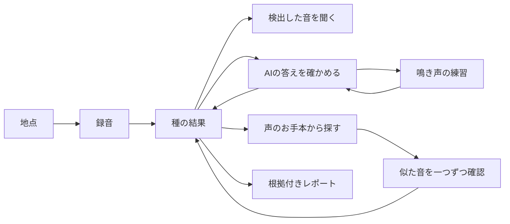

# 非専門家が迷わず進めるUIへの修正方針

2026-09-09。ユーザーから実機UIは不合格との指摘を受けた。以前の動作確認成功は、
使いやすさの合格を意味しない。以下を今回の改修・自己評価の基準にする。

## 出発点

利用者の目的は「この地点の録音から、生き物の声を確かめ、根拠と信頼性を添えて報告する」。
ソフトウェアの機能を覚えること、録音群や検証標本の管理をすることではない。
大学1年生が読んで行動できる日本語を必須とする。

Fableのリストから、今回は次の考え方を使う。手法をすべて導入することは目的にしない。

- 対象と関係を整理してから操作を決める。[OOUX](https://ooux.com/what-is-ooux)
- 目的を達成するための作業順とつまずきを調べる。[NN/g Task Analysis](https://www.nngroup.com/articles/task-analysis/)
- 見た目より先に、場所・操作・移動先を整理する。[Shape Up: Find the Elements](https://basecamp.com/shapeup/1.3-chapter-04)

「選択肢は7個まで」などを普遍的な法則として採用しない。選択に必要な理解と、目的への
寄与で判断する。意味のない選択は削除し、根拠・不確かさなど必要な説明は適切な場所に残す。

## 利用者に見せる対象

| 対象 | 利用者の理解 | 操作 |
|---|---|---|
| 地点 | 録音した場所。同じ場所の録音は後から足せる | 録音を追加・解析・結果を見る |
| 録音 | 録音機で撮った音声ファイル | 聞く。必要なときだけファイルを確認 |
| 種 | この場所で探したい生き物 | 声・時期を見る、確かめる、お手本から探す |
| 声のお手本 | 名前がわかっている生き物の鳴き声 | XC/PCから選び、鳴いている部分を指定 |
| 確認する音 | アプリが提示する短い録音 | 一つ聞いて、一つ答える |
| レポート | 図・表・音・確認結果の一式 | 保存する、保存したものを見る |
| クイズ | 鳴き声を聞き分ける練習 | 始める、鳥を選ぶ、鳴き声を追加する |

内部の Dataset、Segment、SearchRun、校正標本、閾値などを操作メニューの主語にしない。
取り込み単位のデータは出典として内部に残し、既存IDと保存済みレポートは維持する。
地点を単位に現在の解析・検索・検証・出力を揃える。別地点の音を混ぜない。

## 作業の地図と画面の役割

検索・検証・練習を全員が順番に通るウィザードにはしない。地点の結果と種の結果を中心に、
必要な作業へ進み、同じ場所へ戻る。

| 段階 | その画面で答える問い | 主操作 | 戻る先・保持するもの |
|---|---|---|---|
| 地点を選ぶ | どの場所を調べるか | 結果を見る | 地点一覧 |
| 初回の追加 | どこで録音したか、どのフォルダか | この録音を追加 | 地点一覧。名前は場所に一つだけ |
| 2回目の追加 | この地点へ何を足すか | フォルダを選ぶ | 元の地点。座標・時刻設定は再利用 |
| 地点の結果 | どんな声が見つかったか | 気になる種を開く | 地点一覧。解析後も同じ画面に成果を表示 |
| 種の結果 | 本当にこの声か、いつ鳴いたか | 音を聞く | 大きな「種の一覧に戻る」。一覧の位置を保持 |
| 声を探す | 何の声をお手本にするか | この部分を追加／この声を探す | XC一覧の検索条件・位置、追加済み区間を保持 |
| 検索の確認 | この音に対象種の声があるか | 聞こえる／聞こえない／判断できない | 前の音・検索・種の結果。回答は保存 |
| AIの検証 | この短い音に対象種の声があるか | 同じ3つの回答 | 種の結果・練習。回答済み位置から再開 |
| クイズ | どの鳥の声か | クイズを始める | 元の検証。鳥の選択、音の追加は別画面 |
| 書き出し | どの種を報告するか | レポートを書き出す | 地点の結果。キャンセルで設定を失わない |

既定は地点の全録音（図は最大366日）。通常画面の開始日・終了日入力を削除する。
366日を超える地点については、対象を黙って「全期間」と呼ばない。対象期間を表示し、
この場合だけ年の選択を表示し、初期表示は最新年とする。

初回公開も、検索・検証・クイズ・出力を含むユーザー指定のフルワークフローを維持する。
展示用に検証を任意実装へ戻すことはしない。

## 画面内の原則

- 主見出しで「場所・対象・今の作業」がわかる。内部ID・ハッシュ・ファイルパスを見出しにしない。
- 正常な接続状態、終わったジョブの羅列、説明の重複は常設しない。
- 一画面に一つの主作業。大きなボタンと十分な余白を使い、音の再生と回答を近くに置く。
- クイズを始めるために「素材・問題・問題セット」の違いを学ばせない。
- 説明の例：「検出条件を調整」ではなく「AIの間違いを減らす」。統計の抽出方式は作業の入口に置かない。
- 種の結果は実際に検出したモデルを最初に表示。モデル名は比較に必要なので残す。
- 検出がない、解析していない、録音がないを区別。薄い色で検出を見落とさせない。
- 誤検出・見逃しの評価は省略しない。90%は目標であり、達成・未達・根拠不足を区別する。
- 標本の抽出数は作業量として表示。専門的な計算条件は出力に保存し、通常操作から分離する。
- ページ間を戻っても、入力・追加したお手本・回答・確認位置・一覧の位置をできる限り保持する。
- 型チェックやテスト成功だけでUXを合格にしない。実画面を操作して批判的に評価する。

## 確認方法

[操作チェックリスト](ux-checklist-2026-09.md)で、未確認・失敗・修正後確認を区別する。
自分自身の点検は専門家レビューであり、初見ユーザーによる使いやすさの実証ではない。
大学1年生程度の非専門家による観察テストを行う際には、操作名を教えず目的だけ伝える。
